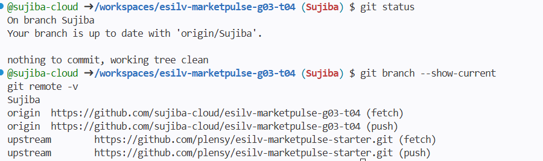
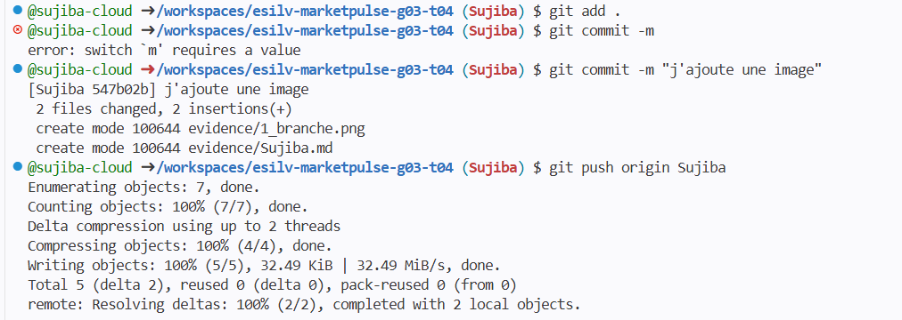
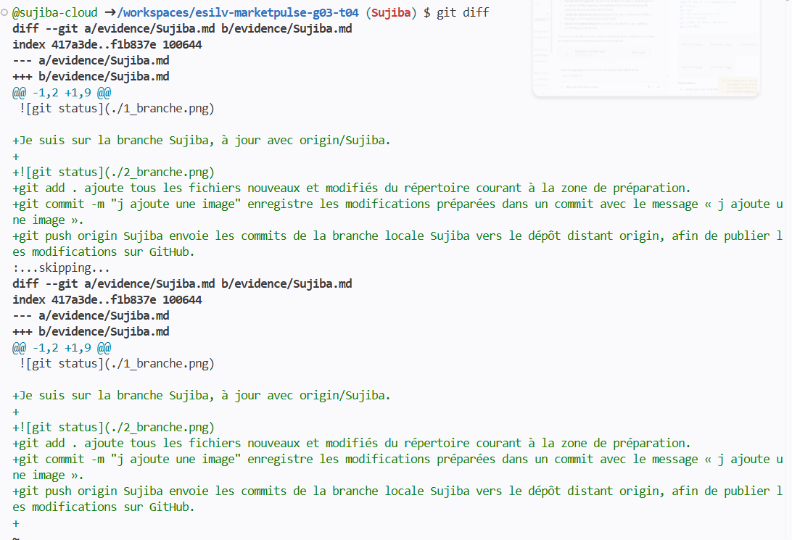

Je suis sur la branche Sujiba, à jour avec origin/Sujiba.

git add . ajoute tous les fichiers nouveaux et modifiés du répertoire courant à la zone de préparation.
git commit -m "j ajoute une image" enregistre les modifications préparées dans un commit avec le message « j ajoute une image ».
git push origin Sujiba envoie les commits de la branche locale Sujiba vers le dépôt distant origin, afin de publier les modifications sur GitHub.

