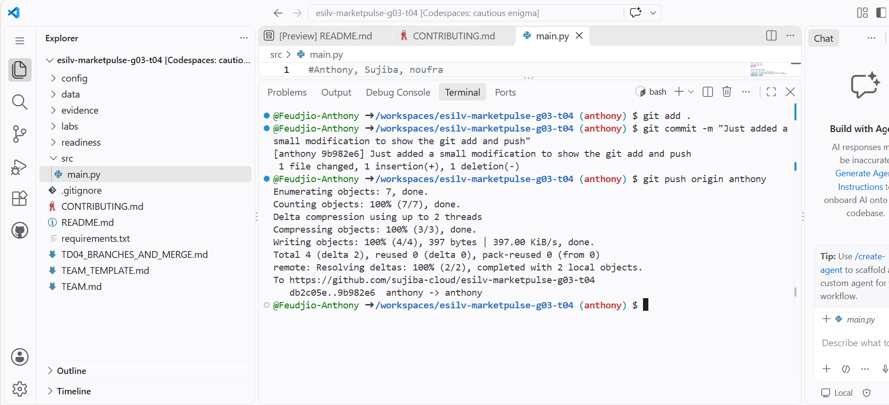
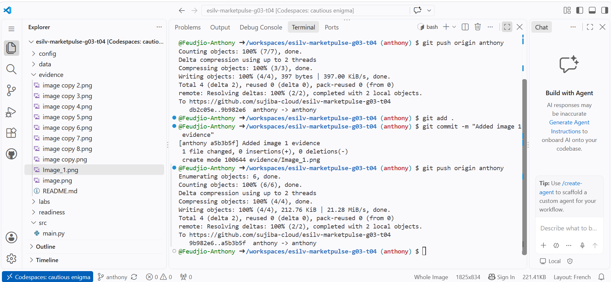
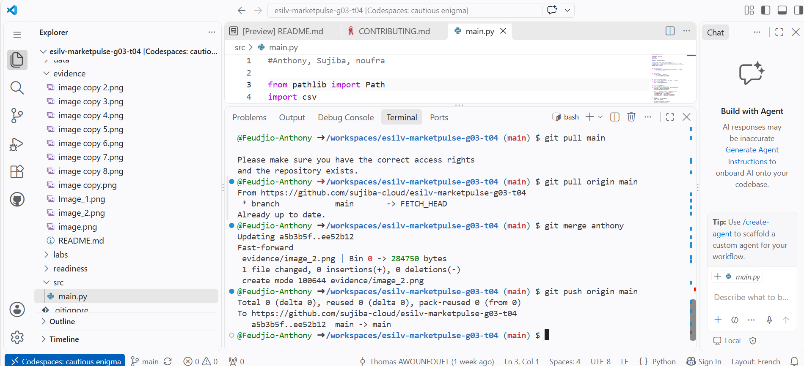

# Preuves de contribution – Feudjio Anthony

## Projet : MarketPulse (esilv-marketpulse-g03-t04)

Ce document présente les captures d'écran attestant de mes contributions au dépôt Git du projet MarketPulse.

---

### Image 1 – Commit et push sur la branche `anthony`

Cette capture montre la création d'un commit sur ma branche personnelle `anthony`, suivi d'un `git push origin anthony` vers le dépôt distant. On peut y voir :

- L'ajout de fichiers via `git add .`
- Le commit avec le message décrivant la modification apportée
- Le push réussi vers `https://github.com/sujiba-cloud/esilv-marketpulse-g03-t04`

---

### Image 2 – Merge de la branche `anthony` dans `main`

Cette capture illustre le processus d'intégration de mes modifications dans la branche principale `main` :

- `git pull origin main` pour récupérer les dernières mises à jour
- `git merge anthony` pour fusionner ma branche dans `main` (fast-forward)
- `git push origin main` pour pousser le résultat du merge sur le dépôt distant

---

### Image 3 – Fichier evidence et historique de travail

Cette capture montre la création du fichier d'evidence dans le dossier `evidence/`, confirmant mon identité sur le projet ainsi que l'arborescence du dépôt avec les dossiers `config/`, `data/`, `evidence/`, `labs/`, `readiness/` et `src/`.

---

*Auteur : Feudjio Anthony – Groupe G03-T04*