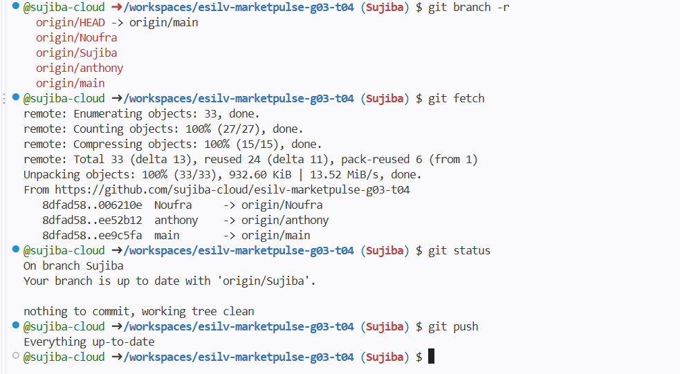
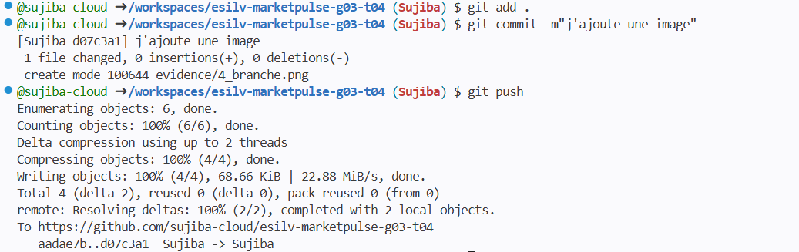

# Evidence – Sujiba

Vérification de l'état de l'arbre de travail (git status), identification de la branche courante (git branch --show-current) et contrôle des dépôts distants configurés (git remote -v). Le statut confirme que la branche locale est à jour avec origin/Sujiba.

Préparation et enregistrement des modifications locales dans le répertoire. Utilisation de git add . pour indexer les fichiers (1_branche.png et Sujiba.md), création du commit avec git commit -m, puis envoi des données vers le dépôt GitHub distant via git push origin Sujiba.

Inspection des modifications en cours avec la commande git diff. La capture montre les lignes ajoutées dans le fichier evidence/Sujiba.md (marquées d'un +) détaillant les explications des commandes Git.

Affichage des branches distantes de l'équipe avec git branch -r (main, Noufra, anthony, Sujiba), suivi de l'exécution de git fetch pour récupérer l'état à jour du dépôt distant.

Ajout d'une nouvelle preuve image (evidence/4_branche.png), suivi du commit et du push final sur la branche Sujiba pour synchroniser les dernières modifications sur GitHub.

